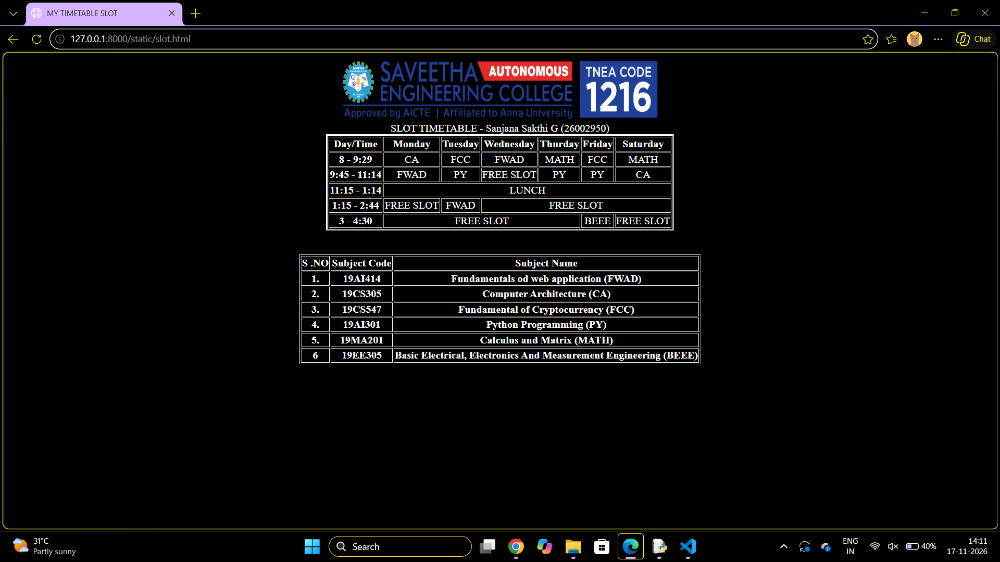

# Ex04 Time Table
## Date: 17.11.2026

## AIM
To write a html webpage page to display your slot timetable.

## ALGORITHM
### STEP 1
Create a Django-admin Interface.

### STEP 2
Create an App inside the Django project.

### STEP 2
Create a static folder uder the created App and insert HTML code.

### STEP 3
Create a simple table using ```<table>``` tag in html with the relevant attributes.

### STEP 4
Add rows using ```<tr>``` tag.

### STEP 5
Add your course schedule using ```<td>``` tag.

### STEP 6
Execute the program using runserver command.

## PROGRAM

```<html>
    <head>
        <title>
            MY TIMETABLE SLOT
        </title>
    </head>
    <body align="center">
        <br>
        <table border="3" cell spacing="20" cell pading="50" align="center">
            <caption> SLOT TIMETABLE - Sanjana Sakthi G (26002950) </caption>
            <tr align="center">
                <th> Day/Time </th>
                <th> Monday </th>
                <th> Tuesday </th>
                <th> Wednesday </th>
                <th> Thurday </th>
                <th> Friday </th>
                <th> Saturday </th>                                                                                             
            </tr>
            <tr align="center">
                <th> 8 - 9:29 </th>
                <td> CA </td>
                <td> FCC </td>
                <td> FWAD </td>
                <td> MATH </td>
                <td> FCC </td>
                <td> MATH </td>
            </tr>
            <tr align="center">
                <th> 9:45 - 11:14 </th>
                <td> FWAD </td>
                <td> PY </td>
                <td> FREE SLOT </td>
                <td> PY</td>
                <td> PY  </td>
                <td> CA </td>
            </tr>
            <tr align="center">
               <th> 11:15 - 1:14 </th>
                <td colspan="6"> LUNCH </td> 
            </tr>
            <tr align="center">
                <th> 1:15 - 2:44 </th>
                <td> FREE SLOT </td>
                <td> FWAD </td>
                <td colspan="4"> FREE SLOT </td>
            </tr>
            <tr align="center">
                <th> 3 - 4:30  </th>
                <td colspan="4"> FREE SLOT </td>
                <td> BEEE </td>
                <td> FREE SLOT </td>
            </tr>
        </table>
        <br><br>
        <table  border="1" cell spacing="5" cell pading="10" align="center">
            <tr align="center">
                <th> S .NO </th>
                <th> Subject Code </th>
                <th> Subject Name</th>
            </tr>
            <tr align="center">
                <th> 1. </th>
                <th> 19AI414 </th>
                <th> Fundamentals od web application (FWAD) </th>
            </tr>
            <tr align="center">
                <th> 2. </th>
                <th> 19CS305 </th>
                <th> Computer Architecture (CA) </th>
            </tr>
            <tr align="center">
                <th> 3. </th>
                <th> 19CS547 </th>
                <th> Fundamental of Cryptocurrency (FCC) </th>
            </tr>
            <tr align="center">
                <th> 4. </th>
                <th> 19AI301 </th>
                <th> Python Programming (PY) </th>
            </tr>
            <tr align="center">
                <th> 5. </th>
                <th> 19MA201 </th>
                <th> Calculus and Matrix (MATH) </th>
            </tr>
            <tr align="center">
                <th> 6 </th>
                <th> 19EE305 </th>
                <th> Basic Electrical, Electronics And Measurement Engineering (BEEE) </th>
            </tr>
        </table>
    </body>
</html>```

## OUTPUT


## RESULT
The program for creating slot timetable using basic HTML tags is executed successfully.
